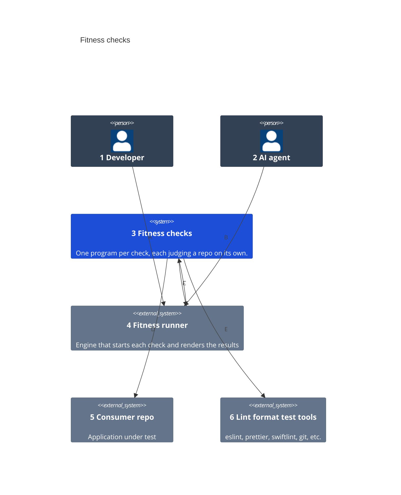
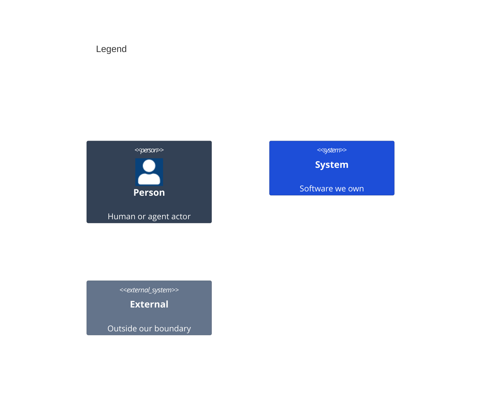

# System Context

Numbers on nodes and letters on arrows match the callout table.

| #   | Description                                                                 | Why                                                     |
| --- | --------------------------------------------------------------------------- | ------------------------------------------------------- |
| 1   | Runs `fitness`, git hooks, or a single check locally.                       | Primary operator; same bar as CI.                       |
| 2   | Claude Code or another agent runs fitness before or after an edit.         | Agents share the same command and exit codes.           |
| 3   | One Go program per check, built from this repo, released on its own line.   | A check change ships without an engine release.         |
| 4   | The fitness-runner engine, which a repo installs beside the checks it uses. | The engine finds and starts each check program.         |
| 5   | Any repo; each check passes clean where it does not apply.                  | Checks run in the consumer's working directory.         |
| 6   | Commodity linters, formatters, test runners, and git.                       | Tool-wrapper checks run these and judge their output.   |
| A   | Local runs and git hooks.                                                   | Fast feedback before a commit.                          |
| B   | Agent hooks and skills run the same command.                                | No separate agent path.                                 |
| C   | The engine starts `fitness-check-<name>` with `--root` and `FITNESS_*` context. | The check protocol is the only contract.            |
| D   | Each check reads the staged files, the tree, or a body it is given.         | The working directory is the app root.                  |
| E   | Tool-wrapper checks exec the underlying tool; native engines need none.     | Orchestration, not reimplementation.                    |
| F   | Each check prints one JSON result and exits 0, 1 or 3.                      | Pass or fail is deterministic, not judged by a model.   |
