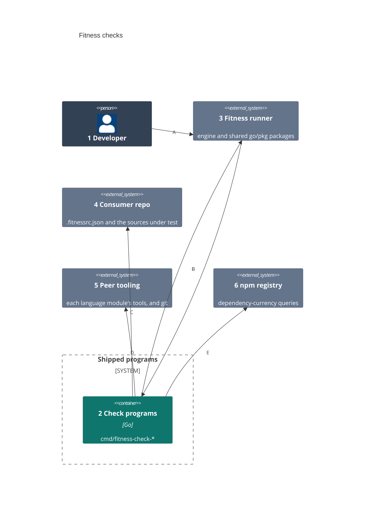
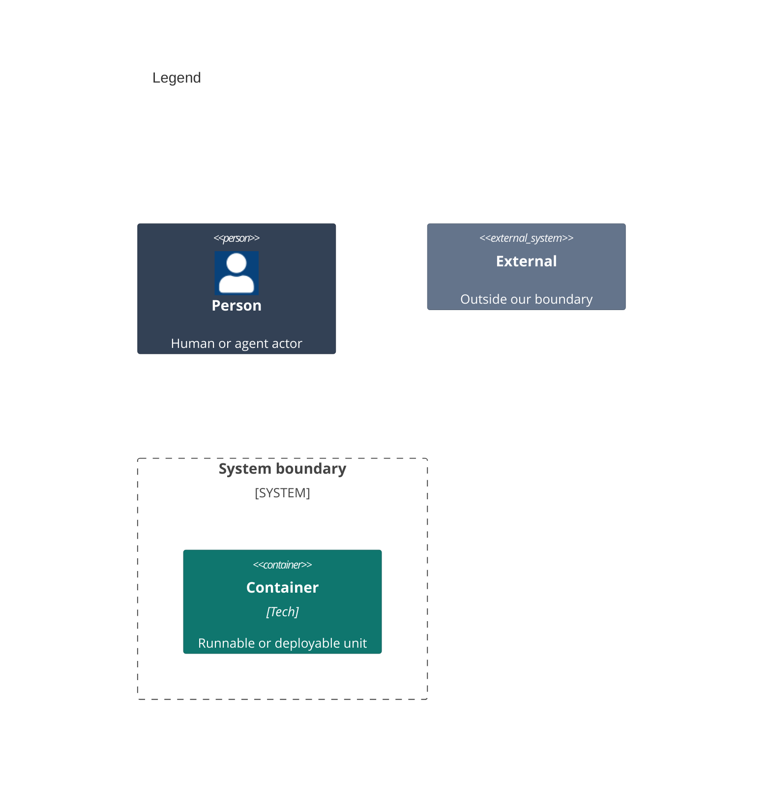

# Containers

Numbers on nodes and letters on arrows match the callout table. Each container names the commands it is built from; a trailing `*` names every sibling folder.

| #   | Description                                                                          | Why                                                   |
| --- | ------------------------------------------------------------------------------------ | ----------------------------------------------------- |
| 1   | Same actor as the system context.                                                    | Every run starts at the engine.                       |
| 2   | One static program per check, each built from its own `cmd/fitness-check-*` folder.  | A repo installs only the checks it uses.              |
| 3   | The engine, and the shared packages each check imports from its Go module.           | One copy of each helper, pinned in `go.mod`.          |
| 4   | Optional `.fitnessrc.json` with per-check options, and the files checks scan.        | Config and the code under test live with the app.     |
| 5   | Tool-wrapper checks exec these when installed.                                       | Peer tools are found at runtime, never bundled.       |
| 6   | dependency-currency queries the registry over HTTPS.                                 | No npm binary needed; offline degrades to pass.       |
| A   | The developer runs `fitness` or a hook.                                              | One front door.                                       |
| B   | The engine starts each check program as its own process.                             | Checks cannot share state.                            |
| C   | Each check reads the config and the tree, staged or full.                            | The working directory is the app under test.          |
| D   | Checks find peer tools the way their language module does, then on PATH.             | A missing tool reports info with an install hint.     |
| E   | Abbreviated registry metadata, honoring the registry `.npmrc` sets.                  | Currency judged without shelling to npm.              |
| F   | Each check links the engine's public packages and answers in its protocol.           | Both sides speak one versioned contract.              |
