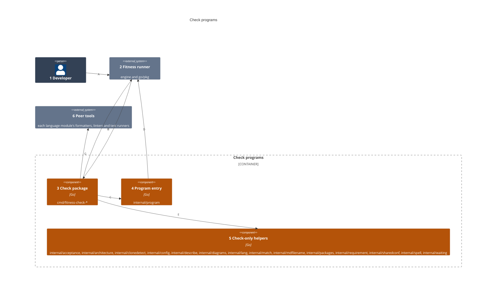
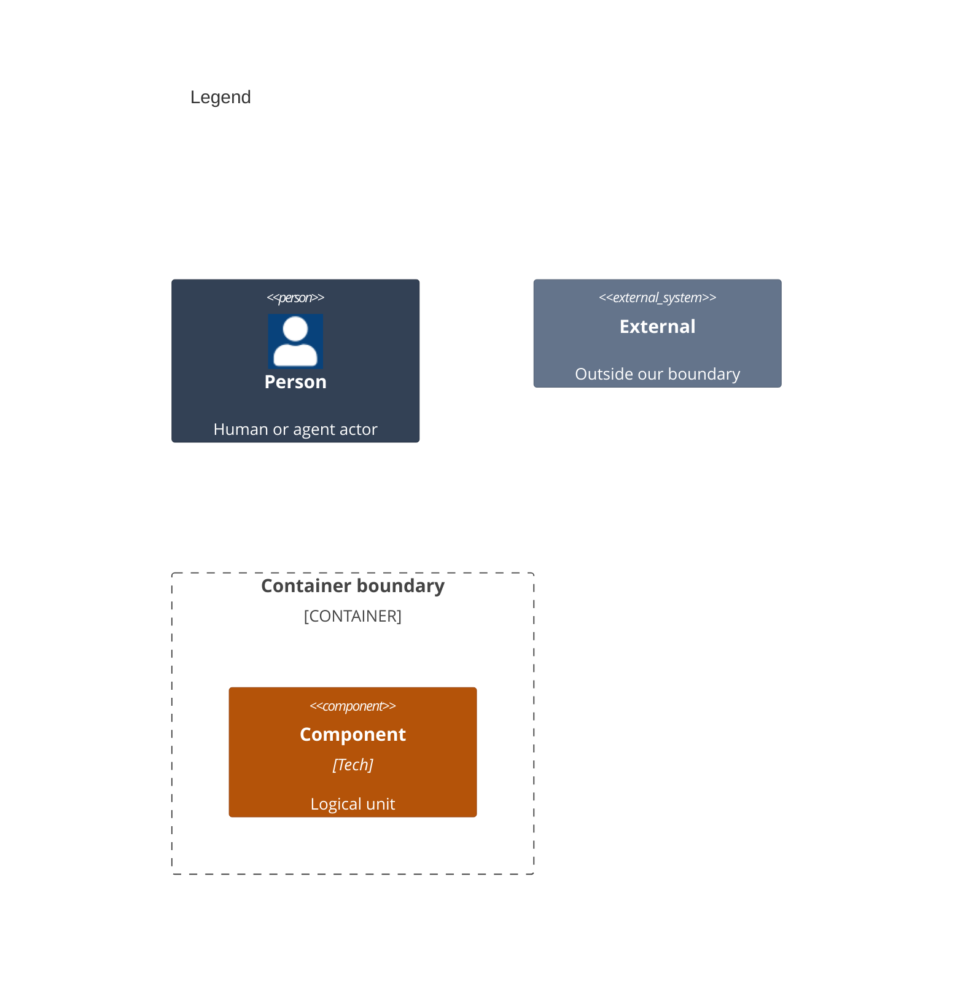

# Components

Numbers on nodes and letters on arrows match the callout table.

| #   | Description                                                                              | Why                                                  |
| --- | ---------------------------------------------------------------------------------------- | ---------------------------------------------------- |
| 1   | Developer or agent runs `fitness`.                                                       | Same entry as the system context.                    |
| 2   | The engine, plus `checkkit` and the other shared packages under its `go/pkg`.            | Checks import the engine's library, never the reverse. |
| 3   | One `package main` per check, whose `main` hands its check to the program entry.         | Each check builds and ships alone.                   |
| 4   | Answers `--describe` with the summary from the README and the protocol number.           | One place speaks the handshake for every check.      |
| 5   | Packages only checks import, such as the spell engine and the architecture model.        | No engine package imports them, so they live here.   |
| 6   | Tool-wrapper checks exec the real peer tool.                                             | Orchestration, not reimplementation.                 |
| A   | User-facing invocation.                                                                  | Sole human entry point.                              |
| B   | The engine starts `fitness-check-<name>` with `--root` and `FITNESS_*` context.          | One execution model for every check.                 |
| C   | `main` passes its embedded README and its `checkkit.Check`.                                  | The summary comes from the README, written once. |
| D   | Every run but `--describe` goes to `checkkit.Main`.                                      | The protocol's emit and exit codes live once.        |
| E   | A check reads models and engines from its helpers.                                       | Shared check logic stays in one package.             |
| F   | Checks build on `checkkit`, `walkfs`, `gitx`, `mdx` and the other public packages.       | One copy of each helper, pinned by version.          |
| G   | Tool wrappers exec their peer binary and parse its output.                               | The check owns tool calls and judgment.              |
