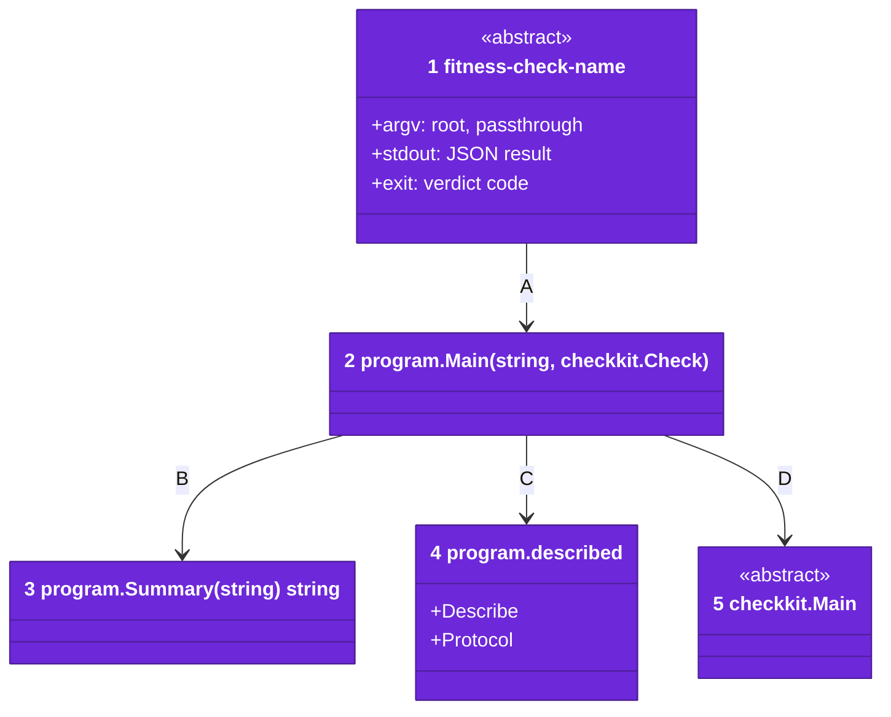
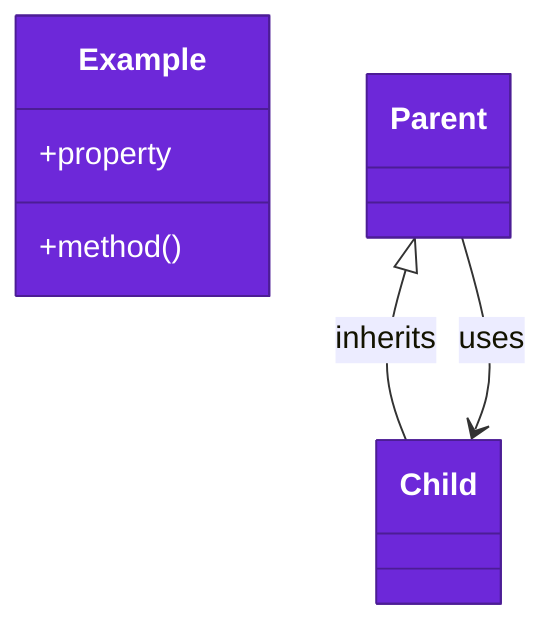

# Code

Numbers on classes and letters on relationships match the callout table.

| #   | Description | Why |
| --- | ----------- | --- |
| 1   | One program per check, started with `--root` and the engine's context; its `main` lives in its `cmd/fitness-check-*/main.go`. | The protocol is the whole interface. |
| 2   | Answers `--describe` itself, else runs the check through `checkkit.Main`, in [program.go](../../internal/program/program.go). | The handshake adds the protocol number. |
| 3   | The first sentence of the check's README in [program.go](../../internal/program/program.go). | The summary is written once, in the README. |
| 4   | The check's metadata plus the protocol number, `program.Protocol`, in [program.go](../../internal/program/program.go). | The engine reads both from one JSON line and fails a run on a mismatch. |
| 5   | The engine library's scaffolding that runs a check and emits its result. | Exit codes and the JSON shape live once. |
| A   | Each check's `main` passes its embedded README and its check. | The check carries its own metadata. |
| B   | `--describe` fills a missing summary from the README. | No generated summary table to keep current. |
| C   | `--describe` prints the metadata with the protocol. | One JSON line per handshake. |
| D   | Every other run goes to the scaffolding. | Runs behave as the bundled check did. |
