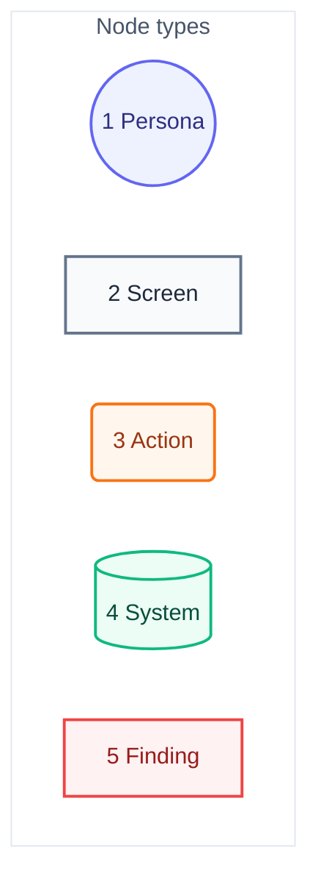
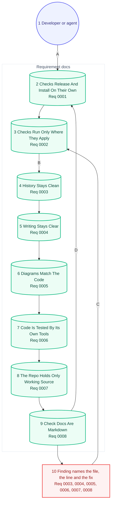

# User Journey

## Legend

Numbers match the callout table. "Screen" is terminal output, since each check is a command-line program.

| #   | Description | Why                                                        |
| --- | ----------- | ---------------------------------------------------------- |
| 1   | Persona     | Developer or AI agent — same command, same exit codes.     |
| 2   | Screen      | What the invoker sees printed to the terminal.             |
| 3   | Action      | A command or file edit the invoker performs.               |
| 4   | System      | A check program's step: judge, report, exit.               |
| 5   | Finding     | A red result that sends the invoker back to fix.           |

## Journey

Each node is one whole requirement doc, in ID order. The nodes between the `journey-nodes` markers are generated from the docs' IDs and titles; run `fitness architecture-journey --fix` to rewrite them. The edges and callout table are hand-written.

Numbers match the callout table. System context: [01-system-context.md](01-system-context.md). Code: [04-code.md](04-code.md).

| #   | Description                                        | Type      | Why                                                                    |
| --- | -------------------------------------------------- | --------- | ---------------------------------------------------------------------- |
| 1   | Developer or AI agent.                             | Persona   | Agents run the same command as a person.                               |
| 2   | Each check builds, tests, releases and installs.   | System    | A person takes one check's fix without the others.                     |
| 3   | Each check judges only the files it fits.          | System    | Any repo runs every check with nothing to configure, fast at any size. |
| 4   | Commit and changelog checks.                       | System    | Each change shows what it was, who helped and which issue it served.   |
| 5   | Prose, spelling, comment and body checks.          | System    | Any doc, issue or PR reads in a minute.                                |
| 6   | Mermaid and architecture view checks.              | System    | Every diagram renders and matches the code it draws.                   |
| 7   | Paired change, tooling and coverage checks.        | System    | Each language's own tools judge the code with the repo's config.       |
| 8   | Build output, duplicate, pin and workflow checks.  | System    | Reviewers see real source only.                                        |
| 9   | Check docs and their move to Markdown.             | System    | People edit each rule as Markdown that GitHub renders.                 |
| 10  | A red row in the results table.                    | Finding   | Each finding says where it is and what to change.                      |
| A   | Run `fitness`, a hook or one check in any repo.    | Connector | The engine installs the latest release first.                          |
| B   | Every check that fits the change runs.             | Connector | A check that does not fit passes with zero files.                      |
| C   | Fix the code, not the check, and rerun.            | Connector | The check measures the real code, so the code changes.                 |
| D   | A green change merges and CI releases it.          | Connector | The loop closes: a release reaches every repo.                         |
