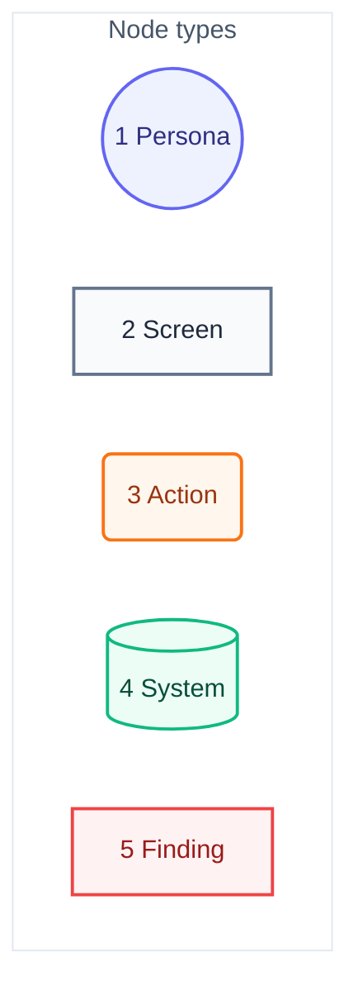
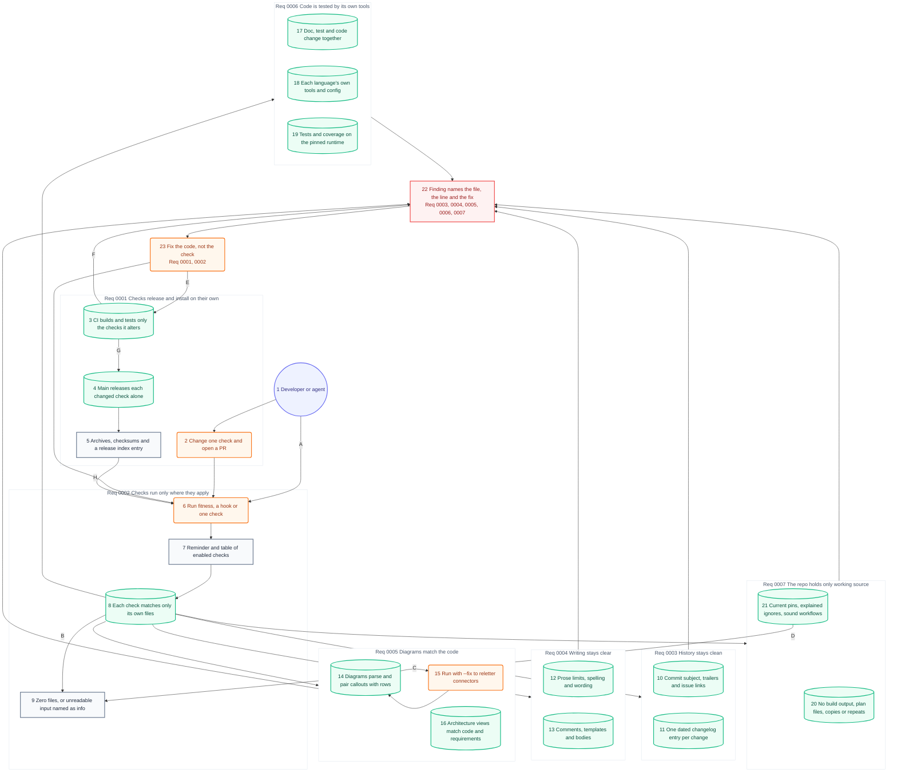

# User Journey

## Legend

Numbers match the callout table. "Screen" is terminal output, since each check is a command-line program.

| #   | Description | Why                                                        |
| --- | ----------- | ---------------------------------------------------------- |
| 1   | Persona     | Developer or AI agent — same command, same exit codes.     |
| 2   | Screen      | What the invoker sees printed to the terminal.             |
| 3   | Action      | A command or file edit the invoker performs.               |
| 4   | System      | A check program's step: judge, report, exit.               |
| 5   | Finding     | A red result that sends the invoker back to fix.           |

## Journey

Each subgroup is one requirement doc, titled with its ID, in order from top to bottom. The `architecture-journey` check reads those titles, so every step inside names its requirement.

Numbers match the callout table. System context: [01-system-context.md](01-system-context.md). Code: [04-code.md](04-code.md).

| #   | Description                                         | Type      | Why                                                                      |
| --- | --------------------------------------------------- | --------- | ------------------------------------------------------------------------ |
| 1   | Developer or AI agent.                              | Persona   | Agents run the same command as a person.                                 |
| 2   | A fix to one check, a shared helper or `go.mod`.    | Action    | A person takes one check's fix without the others.                       |
| 3   | CI on the pull request.                             | System    | It builds, vets, tests and sizes only the checks the change can alter.   |
| 4   | Release on a push to main.                          | System    | Each changed check gets the bump its commits call for, and no other.     |
| 5   | Per-platform archives, checksums and moved majors.  | Screen    | The index lists each published check so the engine installs it alone.   |
| 6   | `fitness`, a git hook, or one check program.        | Action    | Any repo runs every check with nothing to configure.                     |
| 7   | `read-repo-first` output.                           | Screen    | The invoker sees which checks this run enables before reading results.   |
| 8   | Each check's declared file patterns.                | System    | A check judges only what it fits, with a few git calls at any size.      |
| 9   | A pass with zero files, or skips listed as info.    | Screen    | A check that does not apply stays green, and still judges the rest.      |
| 10  | Commit message checks.                              | System    | Typed subjects, Plan and AI trailers, and one link per issue.            |
| 11  | Changelog entry checks.                             | System    | One dated entry of three to five typed bullets, and versions that agree. |
| 12  | Prose and spelling checks.                          | System    | Any doc reads in a minute: short, plain and spelled right.               |
| 13  | Comment, template and body checks.                  | System    | Code comments, docs, Plans and PR bodies follow their rules.             |
| 14  | Mermaid checks.                                     | System    | Every diagram renders and explains each callout in its table.            |
| 15  | `--fix` on connector labels.                        | Action    | Bad letters fix themselves instead of by hand.                           |
| 16  | Architecture view checks.                           | System    | Views match runtimes, folders, symbols and requirement docs.             |
| 17  | Paired change checks.                               | System    | A requirement doc and its one test change in the same commit.            |
| 18  | Go, Node, Swift and Java tooling checks.            | System    | Each language's formatter and linter judge code with the repo's config.  |
| 19  | Test and coverage checks.                           | System    | Every line is covered, on the runtime version the repo pins.             |
| 20  | Build output, design work and duplicate checks.     | System    | Reviewers see real source, with no copies or repeated values.            |
| 21  | Dependency, ignore file and workflow checks.        | System    | Stale pins, bare ignore lines and broken workflow refs never land.       |
| 22  | A red row in the results table.                     | Finding   | Each finding says where it is and what to change.                        |
| 23  | An edit to the code, doc or test.                   | Action    | The check measures the real code, so the code changes.                   |
| A   | Run in any repo.                                    | Connector | A person can start here without changing a check.                        |
| B   | Nothing the check can judge or read.                | Connector | A check that does not fit passes instead of failing.                     |
| C   | Connector letters out of order.                     | Connector | The fix gives each connector and row the next free letter.               |
| D   | The package registry is unreachable.                | Connector | A network outage adds info, not a failure.                               |
| E   | Every check is green on a check change.             | Connector | The fix goes up as a pull request.                                       |
| F   | CI or the size check fails.                         | Connector | The same findings show in CI as on the desk.                             |
| G   | The pull request merges.                            | Connector | Only the merged change releases.                                         |
| H   | The next run installs the new release.              | Connector | The loop closes: a release reaches every repo.                           |
