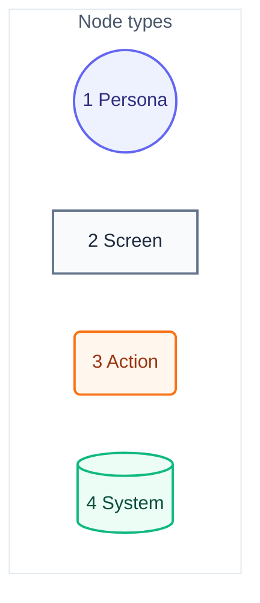

# User Journey

## Legend

Numbers match the callout table. "Screen" is terminal output, since each check is a command-line program.

| #   | Description | Why                                                        |
| --- | ----------- | ---------------------------------------------------------- |
| 1   | Persona     | Developer or AI agent — same command, same exit codes.     |
| 2   | Screen      | What the invoker sees printed to the terminal.             |
| 3   | Action      | A command or file edit the invoker performs.               |
| 4   | System      | A check program's step: judge, report, exit.               |

## Journey

Each step's label ends with the requirement docs it fulfils, by ID. The `architecture-journey` check requires every doc in some label and an ID on every step.

```mermaid
flowchart TB
    dev((1 Developer or agent)):::persona
    runFitness(2 Run fitness or a hook<br/>Req 0003):::action
    startCheck[(3 Engine starts each check program<br/>Req 0003, 0067, 0160)]:::system

    subgraph checks["Check families"]
        commitChecks[(4 Commit messages<br/>Req 0020, 0031, 0049, 0056, 0153)]:::system
        changelogChecks[(5 Changelog<br/>Req 0017, 0018, 0019, 0054)]:::system
        proseChecks[(6 Prose and templates<br/>Req 0006, 0007, 0023, 0044, 0058, 0085, 0152)]:::system
        spellChecks[(19 Spelling<br/>Req 0021, 0156)]:::system
        commentChecks[(7 Code comments<br/>Req 0137, 0139, 0141, 0157)]:::system
        markdownChecks[(8 Markdown files<br/>Req 0033, 0034, 0036, 0037, 0123, 0159)]:::system
        mermaidChecks[(9 Mermaid diagrams<br/>Req 0038, 0039, 0040, 0041, 0042, 0043, 0084)]:::system
        architectureChecks[(10 Architecture views<br/>Req 0070, 0072, 0073, 0074, 0075, 0076, 0154)]:::system
        requirementChecks[(11 Requirements and tests<br/>Req 0005, 0065, 0130, 0132, 0151)]:::system
        goSwiftChecks[(12 Go and Swift code<br/>Req 0026, 0027, 0028, 0029, 0030, 0057, 0097)]:::system
        javaChecks[(13 Java builds<br/>Req 0078, 0079, 0080, 0081)]:::system
        nodeChecks[(14 Node packages and tests<br/>Req 0022, 0024, 0045, 0047, 0052, 0059, 0060)]:::system
        repoChecks[(15 Repo hygiene<br/>Req 0016, 0025, 0032, 0046, 0053, 0055, 0147)]:::system
        workflowChecks[(20 Workflows<br/>Req 0086, 0133)]:::system
        bodyChecks[(16 Issue and PR bodies<br/>Req 0012, 0048, 0050, 0051)]:::system
    end

    results[17 Results table<br/>Req 0003, 0160]:::screen
    ci[(21 CI builds the changed checks<br/>Req 0161)]:::system
    release[(22 Main releases the changed checks<br/>Req 0162, 0163, 0167)]:::system
    fix(18 Fix and rerun<br/>Req 0003):::action
    readmes(23 Read a check's README<br/>Req 0166):::action

    dev --> runFitness
    runFitness --> startCheck
    startCheck --> checks
    checks --> results
    results --> fix
    fix --> runFitness
    fix --> ci
    dev --> readmes
    ci --> release

    classDef persona fill:#eef2ff,stroke:#6366f1,color:#312e81,stroke-width:2px
    classDef screen fill:#f8fafc,stroke:#64748b,color:#1e293b,stroke-width:2px
    classDef action fill:#fff7ed,stroke:#f97316,color:#9a3412,stroke-width:2px
    classDef system fill:#ecfdf5,stroke:#10b981,color:#064e3b,stroke-width:2px

    style checks fill:#ffffff,stroke:#e2e8f0,color:#475569,stroke-width:1px
```

Numbers match the callout table. System context: [01-system-context.md](01-system-context.md). Code: [04-code.md](04-code.md).

| #   | Description                       | Type    | Why                                                                         |
| --- | --------------------------------- | ------- | --------------------------------------------------------------------------- |
| 1   | Developer or AI agent.            | Persona | Agents run the same command as a person.                                    |
| 2   | `fitness`, a hook, or one check.  | Action  | The engine is the front door for every check.                               |
| 3   | Each check program starts alone.  | System  | Each decides whether it applies and depends on no other check or engine code. |
| 4   | Commit message checks.            | System  | Semantic subject, attribution, Plan trailer, and one link per issue.        |
| 5   | Changelog checks.                 | System  | Each change has one dated entry file whose bullets match the change.        |
| 6   | Prose and template checks.        | System  | Docs stay short, readable, spelled right, and shaped by their templates.    |
| 7   | Code comment checks.              | System  | Comments meet the prose limits and hold no dead code or filler.             |
| 8   | Markdown file checks.             | System  | File names, links, and emphasis follow one convention.                      |
| 9   | Mermaid diagram checks.           | System  | Diagrams parse and carry legends, callouts, and tables.                     |
| 10  | Architecture view checks.         | System  | Views match actors, runtimes, folders, symbols, and the journey.            |
| 11  | Requirement and test checks.      | System  | Each acceptance has one test, and a doc changes with its test.              |
| 12  | Go and Swift code checks.         | System  | Format, vet, tests, coverage, complexity, and lint gate the code.           |
| 13  | Java build checks.                | System  | The build checks format, lint, tests and coverage; the JDK meets the pin.   |
| 14  | Node package and test checks.     | System  | Lint, format, Node version, dependencies, and coverage stay current.        |
| 15  | Repo hygiene checks.              | System  | No build output, plan files, unexplained ignores, copied code or ADR files. |
| 16  | Issue and PR body checks.         | System  | Plans, PRs and checklists follow their templates.                           |
| 17  | Results table.                    | Screen  | The engine renders each check's JSON result.                                |
| 18  | Fix and rerun.                    | Action  | The invoker edits the code and runs again.                                  |
| 19  | Spelling checks.                  | System  | Unknown words fail, and an encoded block no one wrote passes.               |
| 20  | Workflow checks.                  | System  | Each workflow ref exists, and each job reports on its run page.             |
| 21  | CI on a pull request.             | System  | It builds and tests only the checks the change can alter.                   |
| 22  | Release on a push to main.        | System  | Each check the push can alter gets its own tag, release and programs.      |
| 23  | Read a check's README.            | Action  | Its stub names the check and links its doc comment, its component and pkg.go.dev. |
